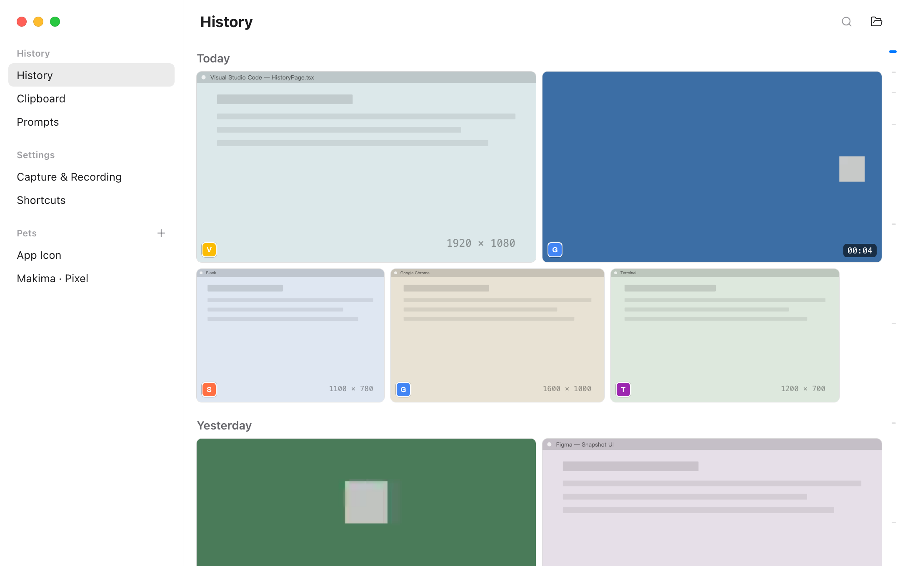
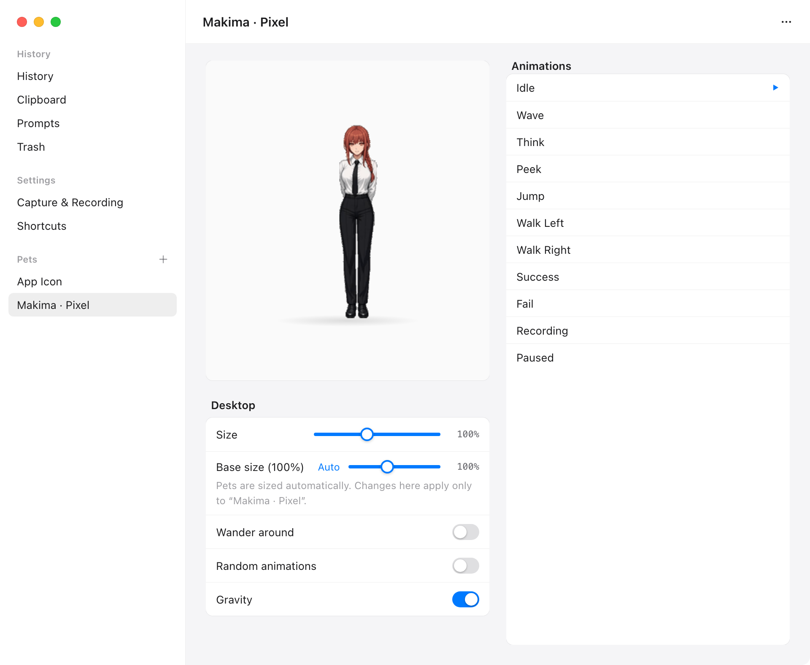
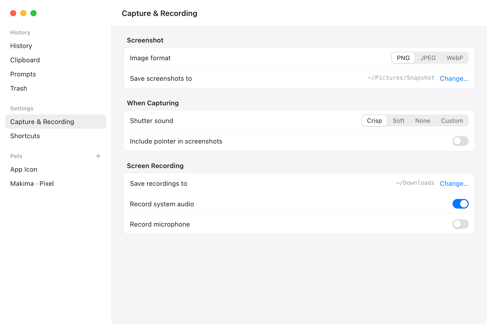
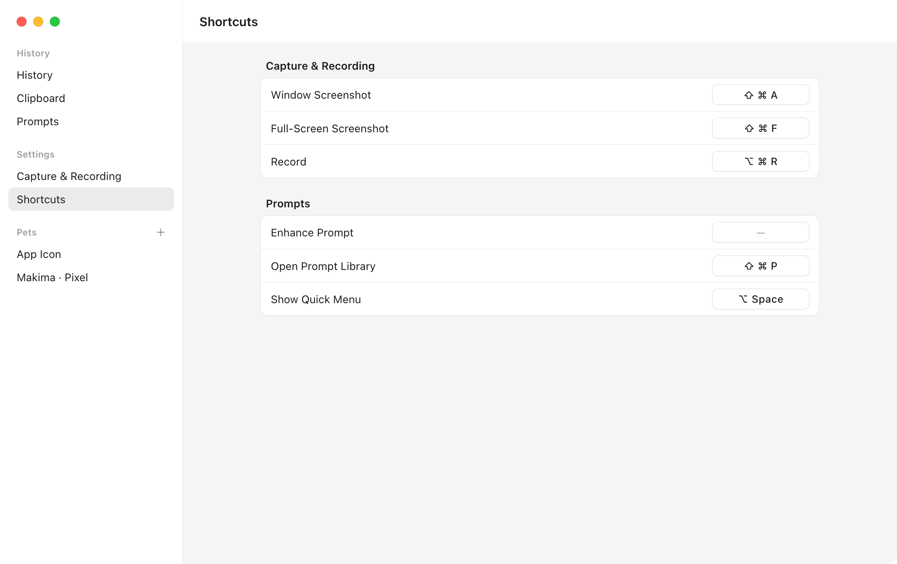
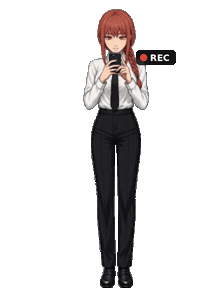
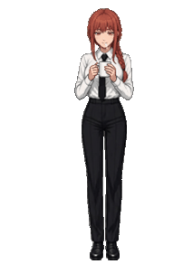

# Snapshot

[](https://github.com/Maxwilldoit/Snapshot/actions/workflows/check.yml)

[简体中文](README.zh-CN.md) | English

A lightweight desktop screenshot and window-recording tool with a little companion that hangs out on your screen.

Take a shot and it's already in your clipboard and your History — ready to paste, annotate, or dig up later. It also records individual windows to MP4, rewrites and saves prompts, and keeps everything tucked behind a small desktop companion. Built with Tauri 2, React, and native adapters for Windows, macOS, and Linux, following your system language and light/dark appearance automatically.

## Inside the App

<table>
  <tr>
    <td align="center" width="50%">
      <br>
      <sub>History — screenshots and recordings grouped by day</sub>
    </td>
    <td align="center" width="50%">
      <br>
      <sub>Companion — preview animations, tune size, wandering, and gravity</sub>
    </td>
  </tr>
  <tr>
    <td align="center" width="50%">
      <br>
      <sub>Capture &amp; Recording — formats, shutter sound, folders, and audio</sub>
    </td>
    <td align="center" width="50%">
      <br>
      <sub>Shortcuts — bind your everyday actions in one place</sub>
    </td>
  </tr>
</table>

## Meet Makima (Companion Animations)

The pixel Makima pack comes from the [Pets catalog](https://github.com/Maxwilldoit/Pets/blob/main/catalog/README.md) and installs in one click from inside the app. Click her to cycle through idle poses, drag her across the screen to watch her walk, and she'll react whenever a capture or recording finishes, fails, starts, or pauses.

<table>
  <tr>
    <td align="center"><br><sub>Idle</sub></td>
    <td align="center"><br><sub>Wave</sub></td>
    <td align="center"><br><sub>Think</sub></td>
    <td align="center"><br><sub>Peek</sub></td>
  </tr>
  <tr>
    <td align="center"><br><sub>Jump</sub></td>
    <td align="center"><br><sub>Walk Left</sub></td>
    <td align="center"><br><sub>Walk Right</sub></td>
    <td align="center" valign="middle"><sub>Event reactions below ↓</sub></td>
  </tr>
  <tr>
    <td align="center"><br><sub>Success</sub></td>
    <td align="center"><br><sub>Fail</sub></td>
    <td align="center"><br><sub>Recording</sub></td>
    <td align="center"><br><sub>Paused</sub></td>
  </tr>
</table>

## Meet Chubby Whale / 大肥鱼 (Interactive Companion)

Adapted from [PC2005-cloud/dsh-pet](https://github.com/PC2005-cloud/dsh-pet) and available in the built-in [Pets catalog](https://github.com/Maxwilldoit/Pets/blob/main/catalog/README.md), installing **大肥鱼 (Chubby Whale)** imports both her 100+ transparent WebM animations and her dedicated mouse-driven interaction profile (while keeping right-click exclusively for Snapshot's quick menu):

- **Left-button mouse interactions (exclusive to 大肥鱼)**: Single-click for playful reactions with Q-bounce squash (or catch her mid-air); drag and flick to throw her with screen-edge bounces and landing squash; double-click and pull back on the second press to launch her like a slingshot; double-click in place to put her to sleep (pausing idle wandering and reactions until a single click wakes her up).
- **100+ autonomous everyday animations**: When wandering and random actions are enabled, non-interactive clips — coding, violin solos, dances, snacks, and seasonal scenes — chain naturally while you work.

<table>
  <tr>
    <td align="center"><br><sub>Turn &amp; Run (原地左转奔跑)</sub></td>
    <td align="center"><br><sub>Sway Dance (轻快摇摆舞)</sub></td>
    <td align="center"><br><sub>Look Around (东张西望)</sub></td>
    <td align="center"><br><sub>Coding (写代码)</sub></td>
  </tr>
  <tr>
    <td align="center"><br><sub>Catnap (原地小憩沉眠)</sub></td>
    <td align="center"><br><sub>Otaku Dance (可爱宅舞)</sub></td>
    <td align="center"><br><sub>Violin Solo (小提琴演奏)</sub></td>
    <td align="center"><br><sub>Humming (悠闲哼歌)</sub></td>
  </tr>
</table>

> **Character Origin & License Notice**: Animations and interaction parameters come from [PC2005-cloud/dsh-pet](https://github.com/PC2005-cloud/dsh-pet) (code under MIT). The "大肥鱼" (Whale Maid) character is a community fan derivative (**not** an official DeepSeek mascot); original character "溟月" by Bilibili [@上善无形](https://space.bilibili.com/4456176), DeepSeek maid-whale design by Bilibili [@ZipZipPipe](https://space.bilibili.com/4168597). The character design and animation media are licensed under [CC BY-NC-SA 4.0](https://creativecommons.org/licenses/by-nc-sa/4.0/) (Attribution-NonCommercial-ShareAlike; [original statement](https://www.bilibili.com/opus/1247156596114456581)) and **may not be used commercially in any form**.

## What It Does

- **Screenshots without the extra steps**: Pick a window or grab the whole screen. Every shot lands on your clipboard and in History right away, and you can open the annotation window whenever you need to mark something up. Linux X11 also supports scrolling capture.
- **Window recording**: Record any single window straight to MP4 (saved in Downloads by default), with optional system audio and microphone capture.
- **Browsable History & Clipboard**: Screenshots and recordings share a day-by-day justified gallery. Hover for an instant sharp preview, or click a screenshot to jump into annotation. macOS and Linux also include clipboard history for external text and images (automatically skipping Snapshot's own History captures so entries aren't duplicated).
- **Quick markup & safety-net Trash**: Crop repeatedly in the markup window (release to crop, keep trimming what's left, undo any step), and tweak Pen or Highlighter color and stroke size from a floating popover. Clicking **Save** puts the edited copy in History and moves the original to **Trash**, where deleted screenshots and recordings can be restored anytime.
- **Prompt rewriting & reusable library**: Point it at any OpenAI-compatible API (your key stays in the OS credential store, never plain text) to polish clipboard drafts with reusable rules. Keep your go-to prompts in the built-in Prompt Library and pull them up anytime with `Ctrl/Cmd+Shift+P`.
- **A low-key desktop companion**: Mirrors the active app icon out of the box, or drop in your own GIF/WebM/ZIP (or grab one from the built-in catalog). Let it wander, play random idle motions, and fall back to the bottom of your screen with gravity. Right-click opens a quick menu; double-click on Windows and Linux opens an app launchpad.
- **Shortcuts & tray controls**: Set global shortcuts for the actions you use most, pause them temporarily from the system tray without losing your bindings, and toggle launch-at-login from the same menu.

## Platform Support

| Feature | Windows | macOS | Linux |
|---|:-:|:-:|:-:|
| Window & fullscreen capture | ✓ | ✓ | ✓ |
| Window recording (MP4) | ✓ | ✓ | ✓ |
| System audio & microphone | ✓ | Mic needs macOS 15+ | ✓ |
| Scrolling capture | — | — | X11 only |
| History, annotation, prompts, companion | ✓ | ✓ | ✓ |
| Clipboard history | — | ✓ | ✓ |
| Launchpad | ✓ | — | ✓ |
| Launch at login | ✓ | ✓ | ✓ |
| Global shortcuts | ✓ | ✓ | Depends on desktop session |

Features your OS doesn't support stay neatly out of the way. Windows has the most real-device coverage so far; remaining hardware checks live in [docs/pending-device-verification.md](docs/pending-device-verification.md).

## Install

Grab the installer for your OS from [Releases](https://github.com/Maxwilldoit/Snapshot/releases):

| Platform | Download |
|---|---|
| Windows 10 / 11 | x64 or ARM64 installer |
| macOS 14+ | Universal ZIP (Apple Silicon & Intel) |
| Ubuntu 22.04+ / Debian 12+ | x86_64 or aarch64 `.deb` |
| Other Linux distros | x86_64 or aarch64 AppImage (glibc 2.35+) |

### First-run notes

Release builds aren't code-signed or notarized yet:
- **macOS**: The first time you open it, Control-click the app and choose **Open**. Snapshot asks for **Screen Recording** to list, capture, and record windows, **Accessibility** to restore minimized windows, and **Microphone** if you record voice. If permission is missing, the picker gives you a direct button to System Settings — enable it and hit **Reload windows** (or quit and reopen if macOS doesn't pick it up immediately).
- **Windows**: If SmartScreen pops up, click **More info → Run anyway**. On Windows 10, the installer downloads WebView2 automatically if it isn't already there.

<details>
<summary>macOS still asking for Screen Recording permission after an update?</summary>

An older ad-hoc signature can stop matching the saved authorization after you replace the app. Open **System Settings → Privacy & Security → Screen Recording**, select the old Snapshot entry and remove it with **−**, then click **+** to add `/Applications/snapshot.app` back and enable it. Quit and reopen Snapshot — no need to touch permissions for any other app.

</details>

<details>
<summary>Optional Linux runtime tools</summary>

Windows and macOS work out of the box. On Linux, install whichever tools match the features you want:

| Tool | Needed for |
|---|---|
| `ffmpeg` | Window recording and cursor-inclusive screenshots |
| `pactl` | System audio & microphone capture via PulseAudio / PipeWire-Pulse |
| `xdotool` | Restoring minimized windows and scrolling capture |
| StatusNotifierHost | System tray (GNOME needs the AppIndicator extension) |

See [scripts/linux/README.md](scripts/linux/README.md) for distro notes and build packages.

</details>

## Making Your Own Companion

Have a favorite GIF or transparent WebM? Drag it straight onto the window (or pack several actions into a ZIP):

- One GIF or WebM per action. Any file with `idle` (or `待机`) in its name becomes the default pose.
- Files with `walk`, `run`, `move`, `走`, or `跑` become walking actions. Add `left` / `right` for directional animations — if you only include one side, the other is mirrored automatically.
- Imported GIFs automatically strip solid edge backgrounds while keeping interior colors (like a white shirt). For WebM, export VP9 with an alpha channel.
- Size limits: 50 MB per animation file, 100 MB per ZIP archive.
- Snapshot measures visible content on import so large transparent margins don't make your companion look tiny; you can fine-tune its baseline size anytime on its page.
- If actions use different canvas sizes, add a `pet.json` to share a base canvas and foot anchor — see the [Pets authoring guide](https://github.com/Maxwilldoit/Pets/blob/main/catalog/README.md#给素材作者按事件设计动作).

## Building from Source

You'll need Node.js 22, Rust 1.98.1, the [Tauri 2 prerequisites](https://v2.tauri.app/start/prerequisites/) for your platform, and a Swift toolchain on macOS for the ScreenCaptureKit recorder. On Debian or Ubuntu, `sudo bash scripts/linux/install-deps.sh` installs the build and runtime packages in one go.

```bash
nvm use
npm ci
npm run tauri dev      # run locally
npm run tauri build    # build release packages
```

<details>
<summary>Checks, macOS local signing, project layout &amp; releases</summary>

### Validation commands

```bash
npm run check              # frontend tests, i18n check, build, Rust fmt / Clippy / tests
npm run check:frontend     # frontend only
npm run check:rust         # Rust only (prepares the macOS recorder automatically)
npm run check:unused       # Knip dead-code report
npm audit --audit-level=moderate
```

For quick UI iteration, `npm run dev` (optionally with `?demo`) runs a browser preview backed by mock data so you won't touch real app files. Capture, recording, and permission changes still need native smoke checks. See [AGENTS.md](AGENTS.md), [DESIGN.md](DESIGN.md), and [docs/SIMPLIFY.md](docs/SIMPLIFY.md) for the code map and workflow rules.

### Local macOS signing

Local `build` / `bundle` runs automatically pick up the single valid **Apple Development** certificate in your Keychain so macOS keeps your Screen Recording authorization across rebuilds. If you have multiple identities, pass `APPLE_SIGNING_IDENTITY="certificate name or fingerprint" npm run tauri build` (don't re-sign afterwards with `codesign --sign -`). CI and explicit `APPLE_SIGNING_IDENTITY=-` produce ad-hoc bundles.

### Project layout

```text
src/
├── pages/              Main window pages
├── windows/            Companion, quick menu, annotation, launchpad, and catalog windows
└── i18n/               English UI messages and coverage checks
src-tauri/
├── src/os/<platform>/  Native capture, recording, input, and startup adapters
└── snapshot-recorder/  macOS ScreenCaptureKit recorder
scripts/                Build, packaging, and localization checks
docs/                   Screenshots and hardware verification notes
```

### Releases

Pushing a `v*` tag triggers the release workflow, building macOS universal, Windows x64/ARM64, and Linux x86_64/aarch64 installers, smoke-testing the Linux packages on Ubuntu 22.04 and 24.04, generating `SHA256SUMS.txt`, and opening a draft GitHub release for final review.

</details>

## License

Copyright (C) 2026 Snapshot contributors.

Snapshot's program source code is released under the [GNU General Public License, version 3 or later](LICENSE) (GPL-3.0-or-later). If you distribute a modified version, you must also release its source under the GPL.

See [THIRD_PARTY_NOTICES.md](THIRD_PARTY_NOTICES.md) for third-party code and separate media notices: behavior and throw/slingshot physics adapted from [PC2005-cloud/dsh-pet](https://github.com/PC2005-cloud/dsh-pet) are under the MIT License; the "大肥鱼" preview GIFs in `docs/screenshots/dsh-pet/` and corresponding catalog pack are separate third-party creative works under [CC BY-NC-SA 4.0](https://creativecommons.org/licenses/by-nc-sa/4.0/) (non-commercial use only) and are excluded from Snapshot's GPL commercial grant.
