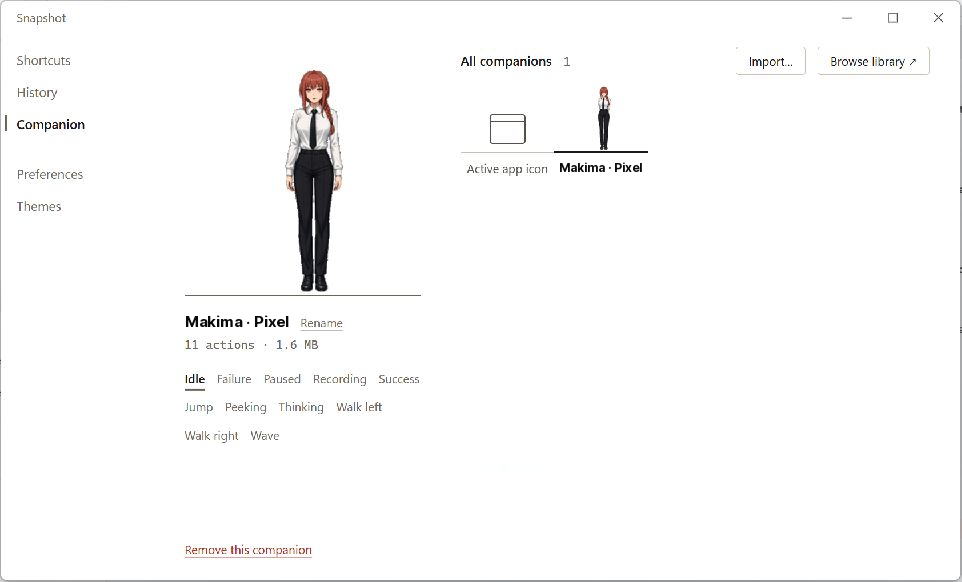
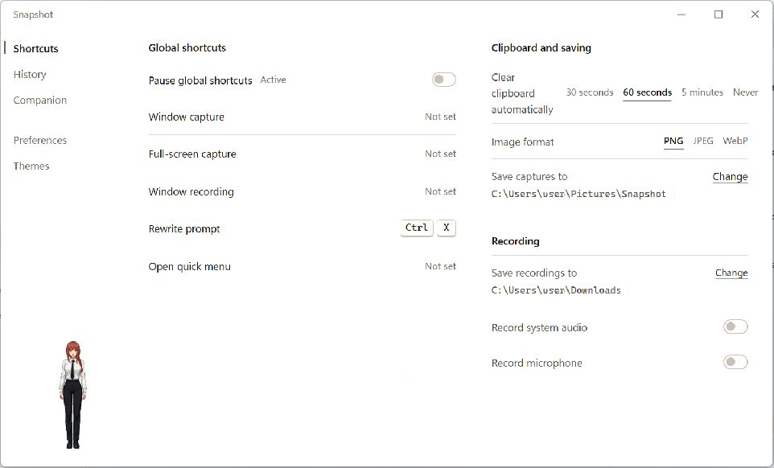
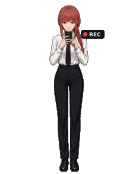

# Snapshot

[](https://github.com/Maxwilldoit/Snapshot/actions/workflows/check.yml)

[简体中文](README.zh-CN.md) | English

Snapshot is a cross-platform desktop utility for capturing application windows, recording them to MP4, annotating screenshots, and rewriting prompts. A desktop companion keeps the most common actions within reach, while a launchpad provides quick access to installed applications.

Built with Tauri 2, React, and native platform APIs for Windows, macOS, and Linux. The interface supports English and Simplified Chinese, follows the system language by default, and can be changed at any time in Preferences.

## Interface

| Companion | Shortcuts and storage |
|---|---|
|  |  |

### Makima's actions

The Makima companion comes from the [Pets library](https://github.com/Maxwilldoit/Pets/blob/main/catalog/README.md). Click the companion to play the next action once; it fades back to idle after one full GIF loop. Drag it sideways to walk.

<table>
  <tr>
    <td align="center"><br>Idle</td>
    <td align="center"><br>Wave</td>
    <td align="center"><br>Thinking</td>
    <td align="center"><br>Peeking</td>
  </tr>
  <tr>
    <td align="center"><br>Jump</td>
    <td align="center"><br>Walk left</td>
    <td align="center"><br>Walk right</td>
    <td align="left" valign="middle"><strong>Feedback</strong><br>Four dedicated actions below.</td>
  </tr>
</table>

<table>
  <tr>
    <td align="center"><br>Success</td>
    <td align="center"><br>Failure</td>
    <td align="center"><br>Recording</td>
    <td align="center"><br>Paused</td>
  </tr>
</table>

## Features

- **Window capture**: capture a selected window or the full screen. Send it to the clipboard, open it for annotation, or save it directly to History. Linux X11 also supports scrolling capture.
- **Window recording**: record a selected window to MP4, with optional system audio and microphone input.
- **Unified history**: screenshots and prompt rewrites appear together in chronological order. Snapshot previews can be copied or annotated; prompt entries retain the original, result, rule, and time. Neither kind has an automatic item limit.
- **Prompt rewriting**: use an OpenAI-compatible endpoint and custom rules. API keys are stored in the operating system credential store, never in the settings file.
- **Desktop companion**: display the active application's icon or an animated GIF. It can roam the current display, play actions while idle, and drop back to the taskbar after dragging. Right-click for quick actions; double-click to open the launchpad. On Windows, the companion steps aside when another app covers the same display in fullscreen.
- **Launchpad**: application catalog caching, icon warming, search, folders, and multi-page navigation keep application launching responsive.
- **Global shortcuts**: bind capture, recording, prompt rewriting, and the quick menu. Pause every global shortcut without losing saved bindings; the paused state persists across restarts.
- **Appearance**: four layout styles, light and dark themes, system-aware color, and reduced-motion support.

## Platform support

| Feature | Windows | macOS | Linux |
|---|:-:|:-:|:-:|
| Window and fullscreen capture | ✓ | ✓ | ✓ |
| Window recording | ✓ | ✓ | ✓ |
| System audio and microphone | ✓ | macOS 15+ for microphone | ✓ |
| Scrolling capture | — | — | X11 only |
| History, annotation, prompt rewriting, companion, launchpad | ✓ | ✓ | ✓ |
| Launch at login | ✓ | ✓ | ✓ |
| Global shortcuts | ✓ | ✓ | Depends on the desktop session |

Capabilities are detected at runtime. Windows has received the most hardware testing; remaining platform checks are tracked in [docs/pending-device-verification.md](docs/pending-device-verification.md).

## Install

Download the package for your platform from [Releases](https://github.com/Maxwilldoit/Snapshot/releases).

| Platform | Package |
|---|---|
| Windows 10/11 | x64 or ARM64 installer |
| macOS 14+ | Universal ZIP for Apple Silicon and Intel |
| Ubuntu 22.04+ / Debian 12+ | x86_64 or aarch64 `.deb` |
| Other Linux distributions | x86_64 or aarch64 AppImage, glibc 2.35+ |

The packages are not code-signed or notarized. On macOS, Control-click the app and choose **Open** the first time. On Windows, SmartScreen may show a warning. Windows 10 downloads the WebView2 runtime during installation when needed.

macOS requires Screen Recording permission for capture and recording, Accessibility permission to restore minimized windows, and Microphone permission for audio recording.

### Linux dependencies

Windows and macOS need no additional runtime tools. Install these Linux tools as needed:

| Tool | Purpose |
|---|---|
| `ffmpeg` | Window recording and pointer-inclusive still capture |
| `pactl` | System audio and microphone recording through PulseAudio or PipeWire-Pulse |
| `xdotool` | Restoring minimized windows and scrolling capture |
| StatusNotifierHost | System tray; GNOME requires the AppIndicator extension |

See [scripts/linux/README.md](scripts/linux/README.md) for distribution details and build dependencies.

## Use

**Quick actions.** Right-click the companion or press the quick-menu shortcut. The menu can capture a window, capture the full screen, record, or rewrite the prompt currently on the clipboard. Arrow keys move through actions, Enter runs one, and Escape closes the menu.

**Capture.** A capture goes to the clipboard by default and is cleared after 60 seconds unless something else replaces it. Preferences can instead open the annotation window or save only to History. Clipboard timing, image format, and folders are configured under **Shortcuts → Clipboard and saving**.

**Recording.** Window recordings are saved as MP4 in Downloads by default. Change the folder and audio inputs under **Shortcuts → Recording**. System audio and microphone options are independent.

**Prompt rewriting.** Configure the API URL and model under **Preferences → System and model**, then edit reusable rules under **Rewrite rules**. Start a rewrite from the quick menu or its global shortcut. Successful results, along with the original text, are added to History.

**Companion and launchpad.** Import a ZIP of GIFs or a single GIF from the Companion page. Under **Preferences → Desktop companion**, enable **Free roam** or **Random actions** for autonomous behavior, and **Gravity** to make a dragged companion fall back to the work-area floor. Click once to play another action; double-click to open the launchpad. The launchpad supports search, folders, drag-and-drop organization, and paged navigation. Published companions can also be installed from the built-in [Pets library](https://github.com/Maxwilldoit/Pets/blob/main/catalog/README.md).

**Language and appearance.** Choose **System**, **Simplified Chinese**, or **English** under **Preferences → Interface language**. The Themes page controls layout, color, and motion.

## Companion assets

- Use one GIF per action. A file whose name contains `idle` becomes the default pose.
- Files containing `walk`, `run`, or `move` become directional walking actions. Include `left` or `right` in the filename to select a direction; the other direction is mirrored when only one is available.
- Painted backgrounds are removed on import while interior colors such as a white shirt are preserved.
- Archives are limited to 100 MB; individual GIFs are limited to 50 MB.
- Actions with a larger canvas can use a `pet.json` file for a shared base canvas and foot anchors. The [Pets authoring guide](https://github.com/Maxwilldoit/Pets/blob/main/catalog/README.md#给素材作者按事件设计动作) documents the format.

## Build from source

Requirements: Node.js 22, Rust 1.98.1, the [Tauri 2 prerequisites](https://v2.tauri.app/start/prerequisites/) for your platform, and a Swift toolchain on macOS for the ScreenCaptureKit recorder.

```bash
npm install
npm run tauri dev
npm run tauri build
```

On Debian or Ubuntu, `sudo bash scripts/linux/install-deps.sh` installs the required build and runtime packages.

## Validation

```bash
npm test          # translation coverage + frontend tests
npm run build     # TypeScript and production frontend build

cd src-tauri
cargo fmt --check
cargo clippy --all-targets -- -D warnings
cargo test
```

CI runs the frontend suite and Rust checks on Windows, macOS, Ubuntu 22.04, and Ubuntu 24.04 through [check.yml](.github/workflows/check.yml). Release packages are built and smoke-tested by [release.yml](.github/workflows/release.yml) and [linux-packages.yml](.github/workflows/linux-packages.yml).

## Project structure

```text
src/
├── pages/              Main window pages
├── windows/            Companion, quick menu, annotation, launchpad, and library windows
└── i18n/               English UI messages and coverage checks
src-tauri/
├── src/os/<platform>/  Platform-specific capture, recording, input, and startup code
└── snapshot-recorder/  macOS ScreenCaptureKit recorder
scripts/                 Build, packaging, and localization checks
docs/                    Platform verification notes and screenshots
```

Shared product behavior lives in the React and Rust application layers. Features owned by the operating system use native APIs per platform, including Windows.Graphics.Capture with Media Foundation, ScreenCaptureKit with AVAssetWriter on macOS, and portal/PipeWire or ffmpeg on Linux.

## Releases

Pushing a `v*` tag runs the release workflow. It builds macOS universal, Windows x64/ARM64, and Linux x86_64/aarch64 packages, validates the Linux packages on Ubuntu 22.04 and 24.04, writes `SHA256SUMS.txt`, and creates a draft GitHub release for final review.

## License

Copyright (C) 2026 Snapshot contributors.

Released under the [GNU General Public License, version 3 or later](LICENSE) (GPL-3.0-or-later). Modified versions distributed to others must also be released under the GPL with corresponding source code.
