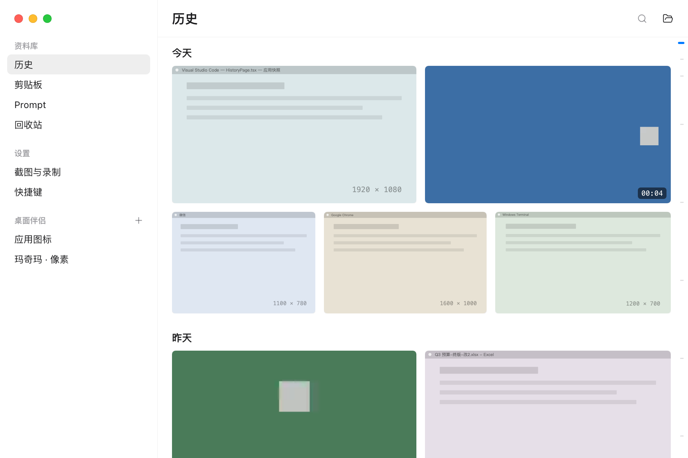
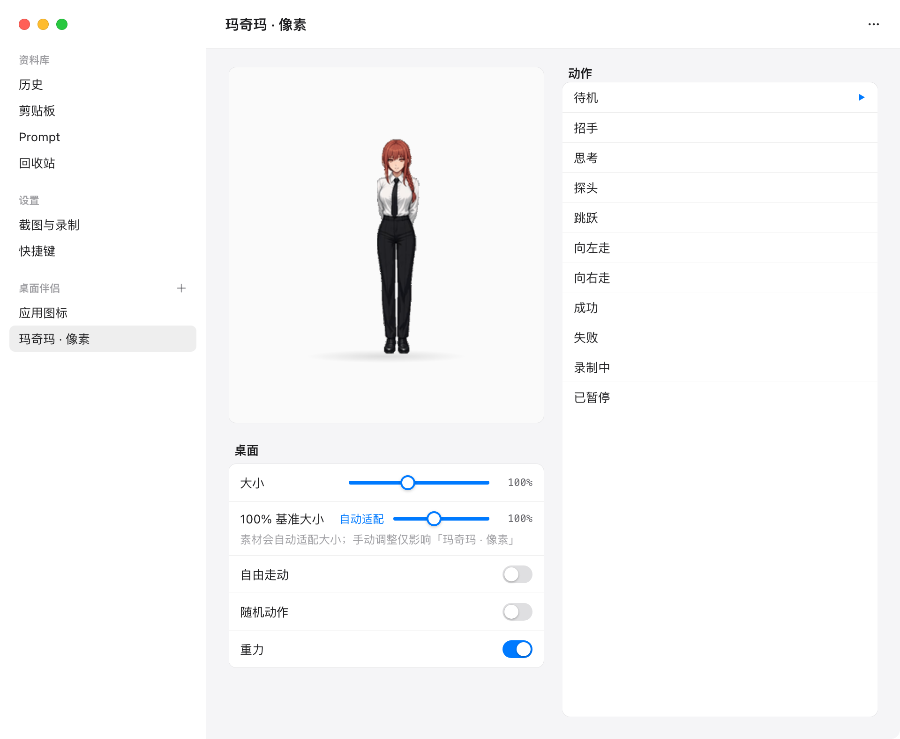
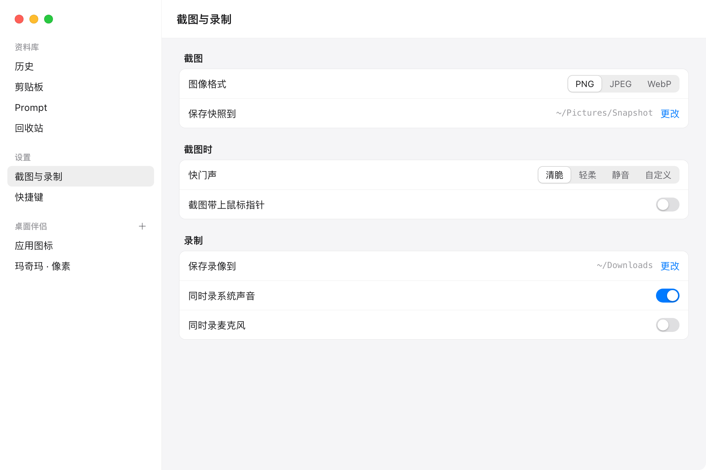
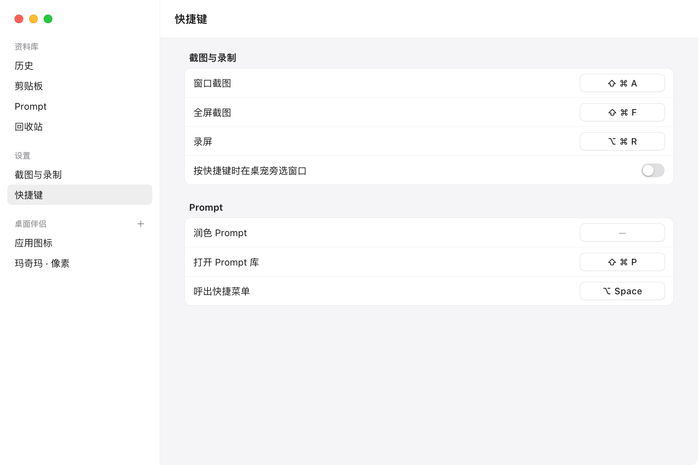
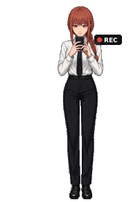

# 应用快照

[](https://github.com/Maxwilldoit/Snapshot/actions/workflows/check.yml)

简体中文 | [English](README.md)

一个轻量、顺手的桌面截图和录屏小工具，附带一只在桌面上陪你干活的小伴侣。

截完图自动进剪贴板、自动留一份在历史里，想标注、翻旧图或者录一段窗口操作都能一步到位；顺手还塞进了 Prompt 润色和常用 Prompt 库。用 Tauri 2 + React 和三端原生能力写的，支持 Windows、macOS 和 Linux，中英文和浅色/深色主题自动跟系统走。

## 应用界面

<table>
  <tr>
    <td align="center" width="50%">
      <br>
      <sub>历史记录：截图和录屏按天排在一起</sub>
    </td>
    <td align="center" width="50%">
      <br>
      <sub>桌面伴侣：调大小、试动作、开自由走动和重力</sub>
    </td>
  </tr>
  <tr>
    <td align="center" width="50%">
      <br>
      <sub>截图与录制：图片格式、快门声、保存目录和录音开关</sub>
    </td>
    <td align="center" width="50%">
      <br>
      <sub>快捷键：常用操作随手改</sub>
    </td>
  </tr>
</table>

## 桌宠动作预览（玛奇玛 · 像素）

这套像素版玛奇玛来自配套的 [Pets 素材库](https://github.com/Maxwilldoit/Pets/blob/main/catalog/README.md)，在应用里点一下就能装上。平时放在桌面上，点她会轮流做动作，拖着走会自动切到走路动画，截图成功、失败或者正在录屏时也会给出对应的反馈表情。

<table>
  <tr>
    <td align="center"><br><sub>待机</sub></td>
    <td align="center"><br><sub>招手</sub></td>
    <td align="center"><br><sub>思考</sub></td>
    <td align="center"><br><sub>探头</sub></td>
  </tr>
  <tr>
    <td align="center"><br><sub>跳跃</sub></td>
    <td align="center"><br><sub>向左走</sub></td>
    <td align="center"><br><sub>向右走</sub></td>
    <td align="center" valign="middle"><sub>下面四个是截图/录屏时的状态反馈 ↓</sub></td>
  </tr>
  <tr>
    <td align="center"><br><sub>成功</sub></td>
    <td align="center"><br><sub>失败</sub></td>
    <td align="center"><br><sub>录制中</sub></td>
    <td align="center"><br><sub>已暂停</sub></td>
  </tr>
</table>

## 平时能拿它干嘛

- **截窗口、截全屏，不绕弯**：挑一个窗口或者直接截全屏，截完立刻进剪贴板，同时自动存进历史记录。想圈重点就点一下打开标注窗口。Linux X11 上还支持滚动长截图。
- **盯着单个窗口录屏**：选好窗口就能录成 MP4，默认存到下载目录，也支持把系统声音和麦克风一起录进去。
- **翻旧图很省心**：截图和录屏都在「历史」里按天拼成照片墙，右侧有时间尺可以快速拖，鼠标移上去直接浮出高清预览，点一下就能接着标注。macOS 和 Linux 上还顺带有一份剪贴板历史。
- **随手润色 & 存 Prompt**：填上任意 OpenAI 兼容接口（API Key 存在系统钥匙串/凭据库，不会写明文），快捷键就能把剪贴板里的草稿整理成清晰的指令；常用的 Prompt 也可以单独存进 Prompt 库，默认按 `Ctrl/Cmd+Shift+P` 就能搜出来直接复制。
- **一只不吵人的桌面伴侣**：默认显示你当前在用的应用图标，也可以把 GIF、WebM 或素材 ZIP 直接拖进窗口，或者从内置素材库挑现成的。能自己在屏幕边溜达、发呆时随机做动作、拖起来松手会带着重力落回任务栏上沿。右键呼出快捷菜单；Windows 和 Linux 双击还能打开应用启动台。
- **快捷键和托盘**：全局快捷键随时改，临时不想误触可以在系统托盘里一键暂停（配置不会丢）；开机启动也在托盘里开关。

## 各平台支持情况

| 功能 | Windows | macOS | Linux |
|---|:-:|:-:|:-:|
| 窗口截图 / 全屏截图 | ✓ | ✓ | ✓ |
| 窗口录屏（MP4） | ✓ | ✓ | ✓ |
| 录系统声音与麦克风 | ✓ | 麦克风需 macOS 15+ | ✓ |
| 滚动长截图 | — | — | 仅 X11 |
| 历史、标注、Prompt 润色与 Prompt 库、桌面伴侣 | ✓ | ✓ | ✓ |
| 剪贴板历史 | — | ✓ | ✓ |
| 应用启动台 | ✓ | — | ✓ |
| 开机启动 | ✓ | ✓ | ✓ |
| 全局快捷键 | ✓ | ✓ | 取决于桌面环境 |

不支持的系统能力会自动隐藏，不会报错卡壳。目前 Windows 跑过的真机测试最全，各端还在持续补测的项目记在 [docs/pending-device-verification.md](docs/pending-device-verification.md)。

## 下载安装

直接去 [Releases](https://github.com/Maxwilldoit/Snapshot/releases) 下对应安装包就行：

| 系统 | 下载哪个 |
|---|---|
| Windows 10 / 11 | x64 或 ARM64 安装程序 |
| macOS 14+ | Universal ZIP（Apple Silicon 和 Intel 通用） |
| Ubuntu 22.04+ / Debian 12+ | x86_64 或 aarch64 `.deb` |
| 其它 Linux 发行版 | x86_64 或 aarch64 AppImage（需 glibc 2.35+） |

### 首次打开的小提示

目前安装包还没买正式签名和公证：
- **macOS**：第一次打开如果系统拦住了，按住 `Control` 点应用图标选「打开」就行。截图和录屏需要开启「屏幕录制」权限，还原最小化窗口需要「辅助功能」，录人声需要「麦克风」。缺权限时窗口选择器会直接给你跳转按钮，勾完回来点「重新读取」（要是已经勾过还是读不到，彻底退出重开一次即可）。
- **Windows**：SmartScreen 弹蓝框时点「更多信息 → 仍要运行」。Win10 机器如果缺 WebView2，安装器会自动下。

<details>
<summary>macOS 更新版本后权限失效怎么办？</summary>

如果更新覆盖了旧版本、重启后系统还一直要屏幕录制权限，多半是旧版临时签名和系统里存的授权记录对不上了。打开 **系统设置 → 隐私与安全性 → 屏幕录制**，选中旧的「应用快照」点 **−** 删掉，再点 **+** 把 `/Applications/snapshot.app` 重新加进去勾上，然后彻底退出重开应用即可（不用动其它软件的权限）。

</details>

<details>
<summary>Linux 运行依赖（按需安装）</summary>

Windows 和 macOS 开箱即用；Linux 如果要用到录屏、录音或长截图，装上对应工具就行：

| 工具 | 干嘛用的 |
|---|---|
| `ffmpeg` | 窗口录屏，以及带鼠标指针的静态截图 |
| `pactl` | 通过 PulseAudio / PipeWire-Pulse 录系统声音和麦克风 |
| `xdotool` | 还原最小化窗口、滚动长截图 |
| StatusNotifierHost | 系统托盘图标（GNOME 需要装 AppIndicator 扩展） |

更多发行版说明和构建依赖见 [scripts/linux/README.md](scripts/linux/README.md)。

</details>

## 自己做桌面伴侣素材

手头有喜欢的 GIF 或透明 WebM，直接拖进窗口就能用，规则很简单：

- 一个动画文件就是一个动作；文件名带 `idle` 或 `待机` 的会被当成默认站姿。
- 文件名带 `walk`、`run`、`move`、`走`、`跑` 的会被当成走路动作；加上 `left`/`左` 或 `right`/`右` 区分方向（只给一个方向的话，另一边会自动镜像）。
- GIF 导入时会自动抠掉连着画布边缘的背景色，人物身上的白色（比如白衬衫）会好好留着；WebM 请自带透明通道（推荐 VP9 + alpha）。
- 单个动画不超过 50 MB，ZIP 压缩包不超过 100 MB。
- 导入后会自动按实际画面大小帮你适配好默认尺寸，不会被大图里的透明留白撑歪；如果要调大小，可以在伴侣页里单独微调基准尺寸。
- 不同动作画布尺寸不一致时，可以放一个 `pet.json` 统一脚底锚点和基准画布，格式见 [Pets 素材作者指南](https://github.com/Maxwilldoit/Pets/blob/main/catalog/README.md#给素材作者按事件设计动作)。

## 从源码构建

本地需要 Node.js 22、Rust 1.98.1 和对应平台的 [Tauri 2 构建依赖](https://v2.tauri.app/start/prerequisites/)；macOS 还需要 Swift 工具链（用来编 ScreenCaptureKit 录屏组件）。Debian / Ubuntu 可以直接跑 `sudo bash scripts/linux/install-deps.sh` 一键装齐依赖。

```bash
nvm use
npm ci
npm run tauri dev      # 本地跑起来调试
npm run tauri build    # 打正式安装包
```

<details>
<summary>开发检查命令、macOS 签名说明与目录结构</summary>

### 常用检查

```bash
npm run check              # 一次性跑完前端测试、翻译覆盖、构建、Rust fmt / Clippy / test
npm run check:frontend     # 只跑前端部分
npm run check:rust         # 只跑 Rust 部分（macOS 会自动准备好录屏组件）
npm run check:unused       # Knip 检查无用代码
npm audit --audit-level=moderate
```

只调 UI 可以跑 `npm run dev`（地址后面加 `?demo` 会装一套演示数据），不用动真实数据；真机截图、录屏和权限相关改动还是要跑桌面端实测。更多协作约定和代码导览见 [AGENTS.md](AGENTS.md)、[DESIGN.md](DESIGN.md) 和 [docs/SIMPLIFY.md](docs/SIMPLIFY.md)。

### macOS 本地签名

本机跑 `build` / `bundle` 时，脚本会自动找钥匙串里唯一有效的 **Apple Development** 证书来签名，这样每次重新编译覆盖安装不用反复重给屏幕录制权限。如果有多个证书，可以用 `APPLE_SIGNING_IDENTITY="证书名或指纹" npm run tauri build` 指定（不要事后再 `codesign --sign -` 覆盖掉）；CI 或显式传 `APPLE_SIGNING_IDENTITY=-` 会打 ad-hoc 包。

### 目录一览

```text
src/
├── pages/              主窗口里的各个页面
├── windows/            桌宠、快捷菜单、标注、启动台、素材库等独立窗口
└── i18n/               英文文案与翻译覆盖检查
src-tauri/
├── src/os/<platform>/  Windows / macOS / Linux 各自的原生截图、录屏和系统适配
└── snapshot-recorder/  macOS ScreenCaptureKit 录屏组件
scripts/                打包、检查与本地化脚本
docs/                   截图资源与真机验证记录
```

### 发布流程

推送 `v*` 标签后，GitHub Actions 会自动打 macOS universal、Windows x64/ARM64、Linux x86_64/aarch64 安装包，在 Ubuntu 22.04 和 24.04 上跑安装启动校验，生成 `SHA256SUMS.txt` 并建好草稿 Release 等最终确认。

</details>

## 开源协议

Copyright (C) 2026 Snapshot contributors.

本项目采用 [GNU 通用公共许可证第 3 版或更新版本](LICENSE)（GPL-3.0-or-later）开源。如果你修改并分发了本软件，请按 GPL 协议一并公开修改后的源码。
