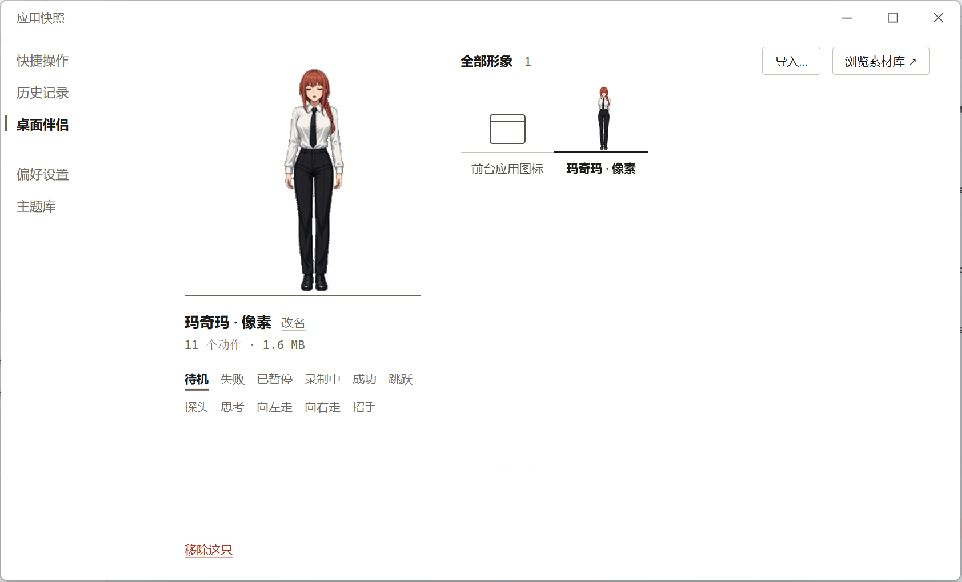
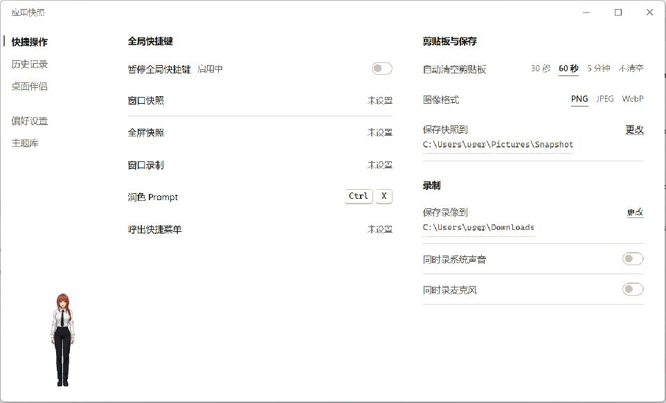

# 应用快照

[](https://github.com/Maxworkinghard/Snapshot/actions/workflows/check.yml)

简体中文 | [English](README.md)

应用快照是一款跨平台桌面工具，用于截取应用窗口、录制窗口视频、标注截图和润色 Prompt。桌面伴侣提供常用操作的快捷入口，启动台则用于快速查找和启动已安装的应用。

应用基于 Tauri 2、React 和各平台原生接口构建，支持 Windows、macOS 和 Linux。界面提供简体中文和英文，默认跟随系统语言，也可以在偏好设置中随时切换。

## 界面

| 桌面伴侣 | 快捷操作与保存 |
|---|---|
|  |  |

## 功能

- **窗口截图**：截取指定窗口或全屏。结果可放进剪贴板、打开标注，或直接保存到历史记录。Linux X11 另支持滚动长截图。
- **窗口录制**：将所选窗口录制成 MP4，可选系统声音和麦克风。
- **统一历史**：截图和 Prompt 润色记录按时间统一排列。截图可预览、复制和标注；Prompt 记录保留原文、结果、规则和时间。
- **Prompt 润色**：支持 OpenAI 兼容接口和自定义规则。API Key 保存在系统凭据库中，不写入设置文件。
- **桌面伴侣**：显示当前应用图标或动画 GIF。左键切换动作，右键打开快捷菜单，双击打开启动台。Windows 下遇到全屏应用时会自动避让。
- **启动台**：应用目录和图标在后台预缓存，支持搜索、文件夹、拖动排序和分页浏览。
- **全局快捷键**：可绑定截图、录制、Prompt 润色和快捷菜单。暂停全局快捷键后绑定仍会保留，重启应用也不会丢失。
- **外观**：提供四种布局、浅色与深色主题、跟随系统和减少动效选项。

## 平台支持

| 功能 | Windows | macOS | Linux |
|---|:-:|:-:|:-:|
| 窗口截图与全屏截图 | ✓ | ✓ | ✓ |
| 窗口录制 | ✓ | ✓ | ✓ |
| 系统声音与麦克风 | ✓ | 麦克风需 macOS 15+ | ✓ |
| 滚动长截图 | — | — | 仅 X11 |
| 历史、标注、Prompt 润色、桌面伴侣、启动台 | ✓ | ✓ | ✓ |
| 开机启动 | ✓ | ✓ | ✓ |
| 全局快捷键 | ✓ | ✓ | 取决于桌面环境 |

应用会在运行时检测功能是否可用。Windows 的真机验证最完整，其余平台待验证项目见 [docs/pending-device-verification.md](docs/pending-device-verification.md)。

## 安装

从 [Releases](https://github.com/Maxworkinghard/Snapshot/releases) 下载对应平台的安装包。

| 平台 | 安装包 |
|---|---|
| Windows 10/11 | x64 或 ARM64 安装程序 |
| macOS 14+ | Apple Silicon 与 Intel 共用的 universal ZIP |
| Ubuntu 22.04+ / Debian 12+ | x86_64 或 aarch64 `.deb` |
| 其它 Linux 发行版 | x86_64 或 aarch64 AppImage，要求 glibc 2.35+ |

安装包目前没有正式代码签名和公证。macOS 首次打开需按住 Control 点击应用并选择“打开”；Windows 上 SmartScreen 可能提示风险。Windows 10 缺少 WebView2 时，安装程序会按需下载。

macOS 截图和录制需要“屏幕录制”权限，还原最小化窗口需要“辅助功能”权限，录音需要麦克风权限。

### Linux 运行依赖

Windows 和 macOS 不需要额外运行工具。Linux 可按需安装：

| 工具 | 用途 |
|---|---|
| `ffmpeg` | 窗口录制，以及包含鼠标指针的静态截图 |
| `pactl` | 通过 PulseAudio 或 PipeWire-Pulse 录制系统声音和麦克风 |
| `xdotool` | 还原最小化窗口和滚动长截图 |
| StatusNotifierHost | 系统托盘；GNOME 需要 AppIndicator 扩展 |

各发行版的构建依赖和支持范围见 [scripts/linux/README.md](scripts/linux/README.md)。

## 使用

**快捷操作。** 右键桌面伴侣，或按下快捷菜单快捷键。菜单可截取窗口、截取全屏、录制窗口，或润色剪贴板里的 Prompt。方向键选择，回车执行，Esc 关闭。

**截图。** 默认放进剪贴板，并在 60 秒后自动清空；期间复制了其它内容则不会误清。偏好设置中可以改为打开标注或仅保存到历史。自动清空时间、图片格式和保存目录位于 **快捷操作 → 剪贴板与保存**。

**录制。** 窗口录像默认保存为 MP4，位于“下载”目录。保存位置以及系统声音、麦克风开关位于 **快捷操作 → 录制**，两个音频来源可以分别启用。

**Prompt 润色。** 在 **偏好设置 → 本机与模型** 中填写接口地址和模型，在 **润色规则** 中维护可复用规则。通过快捷菜单或全局快捷键开始润色，成功结果会连同原文、规则和时间进入历史记录。

**桌面伴侣与启动台。** 在桌面伴侣页导入 GIF 压缩包或单个 GIF。单击播放下一个动作，双击打开启动台。启动台支持搜索、文件夹、拖动整理和分页。也可以直接从内置的 [Pets 素材库](https://github.com/Maxworkinghard/Pets/blob/main/catalog/README.md) 安装已发布的伴侣。

**语言与外观。** 在 **偏好设置 → 界面语言** 中选择 **跟随系统**、**简体中文** 或 **English**。布局、颜色和动效在主题库中调整。

## 伴侣素材

- 每个动作使用一个 GIF；文件名包含 `idle` 的文件作为默认待机动作。
- 文件名包含 `walk`、`run` 或 `move` 的文件属于走路动作；加入 `left` 或 `right` 指定方向。只有一个方向时，另一方向使用镜像。
- 导入时会移除与画布边缘相连的背景色，人物内部的颜色（例如白衬衫）会保留。
- 压缩包上限 100 MB，单个 GIF 上限 50 MB。
- 超出基准画布的动作可通过 `pet.json` 共用基准尺寸和脚底锚点，具体格式见 [Pets 素材作者说明](https://github.com/Maxworkinghard/Pets/blob/main/catalog/README.md#给素材作者按事件设计动作)。

## 从源码构建

需要 Node.js 22、Rust 1.98.1、对应平台的 [Tauri 2 构建依赖](https://v2.tauri.app/start/prerequisites/)；macOS 还需要 Swift 工具链来构建 ScreenCaptureKit 录制组件。

```bash
npm install
npm run tauri dev
npm run tauri build
```

Debian 或 Ubuntu 可运行 `sudo bash scripts/linux/install-deps.sh` 安装构建与运行依赖。

## 验证

```bash
npm test          # 本地化文案覆盖检查 + 前端测试
npm run build     # TypeScript 检查和生产构建

cd src-tauri
cargo fmt --check
cargo clippy --all-targets -- -D warnings
cargo test
```

CI 会在 Windows、macOS、Ubuntu 22.04 和 Ubuntu 24.04 上执行 [check.yml](.github/workflows/check.yml)。安装包由 [release.yml](.github/workflows/release.yml) 与 [linux-packages.yml](.github/workflows/linux-packages.yml) 构建并完成安装启动检查。

## 目录结构

```text
src/
├── pages/              主窗口页面
├── windows/            桌面伴侣、快捷菜单、标注、启动台和素材库窗口
└── i18n/               英文界面文案与覆盖检查
src-tauri/
├── src/os/<platform>/  各平台截图、录制、输入和启动实现
└── snapshot-recorder/  macOS ScreenCaptureKit 录制组件
scripts/                构建、打包和本地化检查脚本
docs/                   平台验证记录与截图
```

跨平台一致的业务逻辑放在 React 和 Rust 应用层；系统能力相关的部分按平台使用原生接口，包括 Windows.Graphics.Capture 与 Media Foundation、macOS 的 ScreenCaptureKit 与 AVAssetWriter，以及 Linux 的 portal/PipeWire 或 ffmpeg。

## 发布

推送 `v*` 标签会启动发布流程，构建 macOS universal、Windows x64/ARM64、Linux x86_64/aarch64 安装包，在 Ubuntu 22.04 和 24.04 上验证 Linux 包，生成 `SHA256SUMS.txt`，并创建供最终检查的 GitHub 草稿发行版。

## 许可证

Copyright (C) 2026 Snapshot contributors.

本项目以 [GNU 通用公共许可证第 3 版或更新版本](LICENSE)（GPL-3.0-or-later）发布。向他人分发修改后的版本时，也必须以 GPL 提供相应源代码。
