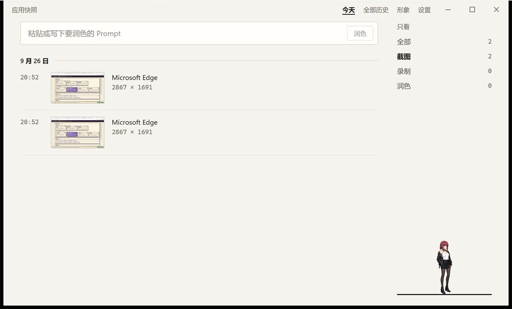
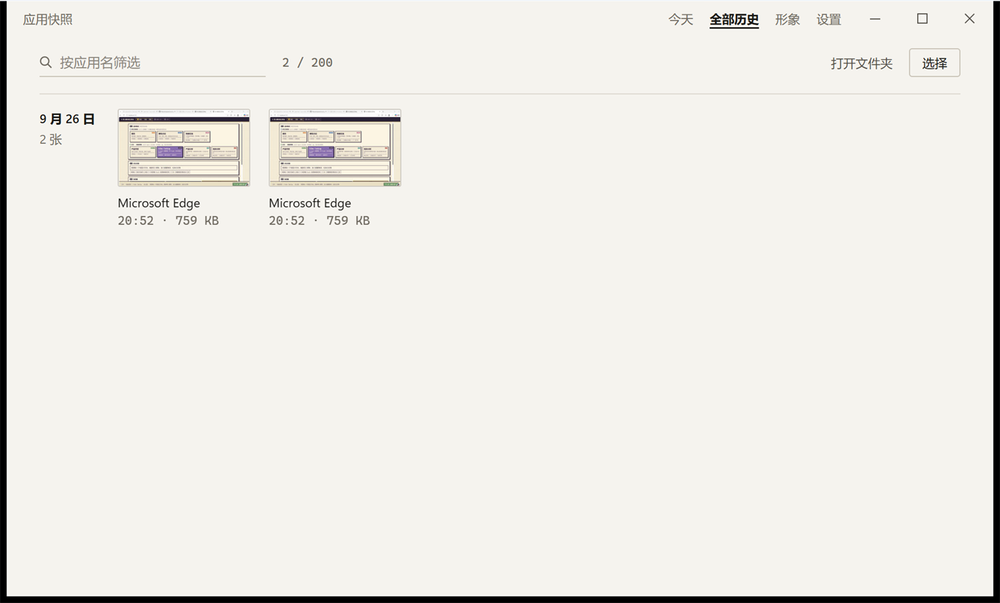
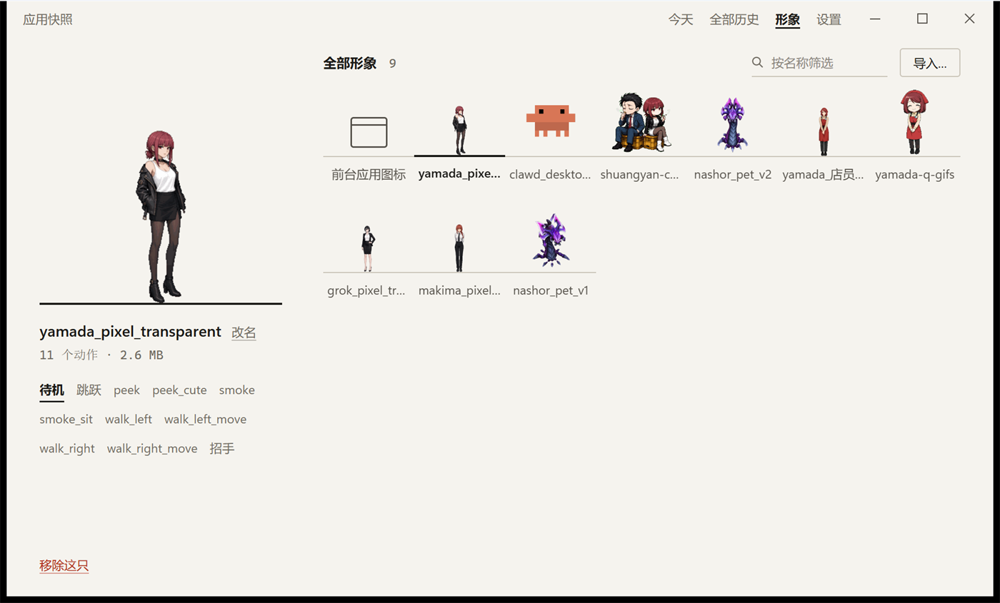
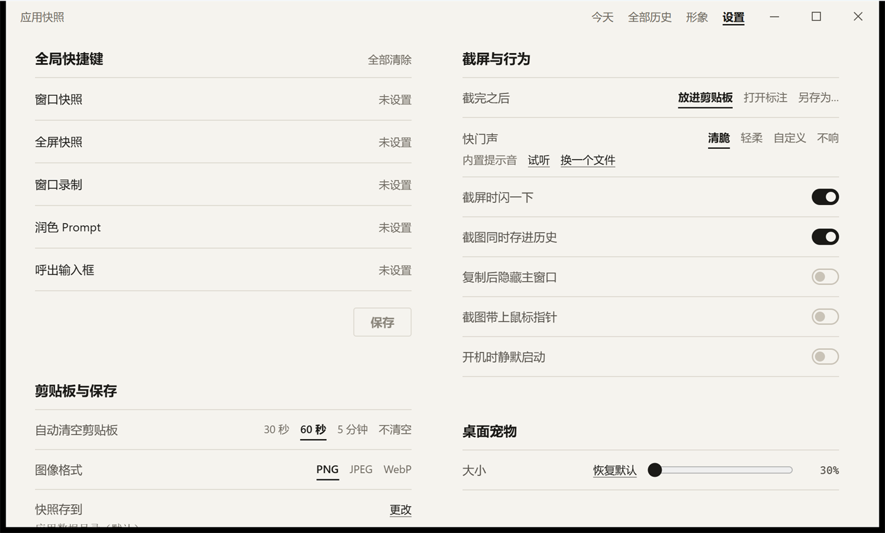
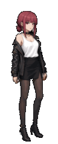
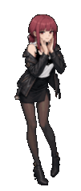

# 应用快照

[](https://github.com/Maxworkinghard/Snapshot/actions/workflows/check.yml)

简体中文 | [English](README.md)

一个桌面截图、录屏小工具，顺带 Prompt 润色和一只桌面伴侣。基于 Tauri 2 + React，一套代码支持 Windows、macOS 和 Linux。

## 界面

<table>
<tr>
<td width="50%"></td>
<td width="50%"></td>
</tr>
<tr>
<td width="50%"></td>
<td width="50%"></td>
</tr>
</table>

桌面上的宠物，点一下换一个动作：

<p align="center">
  
  
  
  
</p>

## 功能

- **窗口快照**：截取指定应用的窗口，默认直接放进剪贴板，也可以截完打开标注或仅保存到历史记录。另有全屏截图，Linux（X11）上还有滚动长截图。
- **窗口录制**：把窗口录成 MP4，可以同时录系统声音和麦克风。
- **历史记录**：快照和 Prompt 润色记录在同一页按时间排列。快照文件默认保存在「图片/Snapshot」，可以再复制或放大标注；Prompt 记录保留原文、润色文、规则和时间。两类记录分别保留最近 200 条。
- **Prompt 润色**：调用任意 OpenAI 兼容接口改写 Prompt，改写规则可以自己增删。
- **桌面伴侣**：桌面上常驻一个悬浮小窗，默认显示当前应用的图标，也可以换成会动的 GIF 形象。右键它呼出快捷菜单，截图、录制、润色都能从这里发起。Windows 下，同一屏幕的前台应用全屏时自动隐藏，退出全屏或切换应用后恢复。
- **全局快捷键**：以上操作都能绑定全局快捷键，主窗口最小化时也能用。可在托盘菜单或快捷键设置页手动暂停，暂停会释放按键并保留绑定，重启后沿用暂停状态；再次手动恢复后生效。

## 平台支持

| 功能 | Windows | macOS | Linux |
|---|:-:|:-:|:-:|
| 窗口截图、全屏截图 | ✓ | ✓ | ✓ |
| 窗口录制 | ✓ | ✓ | ✓ |
| 录制时录系统声音 | ✓ | ✓ | ✓ |
| 录制时录麦克风 | ✓ | macOS 15+ | ✓ |
| 滚动长截图 | — | — | 仅 X11 |
| 开机自启 | ✓ | ✓ | ✓ |
| 历史记录、Prompt 润色与预览标注、桌面伴侣 | ✓ | ✓ | ✓ |

功能是否可用由应用在运行时检测。Linux 上的录制、录音等功能依赖外部工具，见[运行依赖](#运行依赖)。

目前 Windows 上的真机验证最充分，macOS 和 Linux 还有部分功能待真机确认，清单见 [docs/pending-device-verification.md](docs/pending-device-verification.md)。

## 安装

从 [Releases](https://github.com/Maxworkinghard/Snapshot/releases) 下载对应平台的安装包。目前已发布 Windows（x64 / ARM64）和 Linux（x86_64 / aarch64）版，macOS 版稍后发布；也可以[从源码构建](#从源码构建)。

系统要求：

- **macOS**：14 及以上，Apple Silicon 和 Intel 共用一个 universal 包
- **Windows**：10 / 11，x64 或 ARM64
- **Linux**：x86_64 或 aarch64，X11 或 Wayland 桌面会话；Ubuntu 22.04 / Debian 12 及以上装 deb，其它发行版用 AppImage（要求 glibc 2.35 及以上）。Ubuntu 20.04 及更早的系统不支持

安装包没有正式签名和公证：macOS 首次打开要按住 Control 点击 →「打开」，Windows 上 SmartScreen 可能会拦截。

### 权限

macOS 上截图和录制需要「屏幕录制」权限，截最小化的窗口需要「辅助功能」权限（用来先把窗口还原），录麦克风需要麦克风权限。

### 运行依赖

Windows 和 macOS 不需要另装东西（Windows 10 上安装程序会按需下载 WebView2 运行时）。Linux 上按需安装：

| 工具 | 用途 |
|---|---|
| `ffmpeg` | 窗口录制；带鼠标指针的截图（没有时截图不带指针） |
| `pactl`（PulseAudio 或 PipeWire-Pulse） | 录系统声音和麦克风，还要求 ffmpeg 带 PulseAudio 支持 |
| `xdotool` | 截图前还原最小化的窗口；滚动长截图 |
| StatusNotifierHost | 系统托盘（KDE 自带，GNOME 要装 AppIndicator 扩展） |

## 使用

启动后桌面上会出现伴侣（默认显示当前应用的图标），系统托盘里也有应用图标。

启动台会在程序启动后后台扫描本机应用，并预热首批图标。应用清单单独缓存在本地，重启后可直接复用；打开启动台优先显示缓存，再按需后台检查新增和卸载的应用（扫描间隔至少 60 秒，更新结果在下次打开时显示）。首次安装后运行就开始准备；如果在首次扫描完成前打开，仍可能短暂显示读取提示。

点击「桌面伴侣 → 浏览素材库」会打开可独立缩放的素材库窗口，可浏览 [Pets 公开目录](https://github.com/Maxworkinghard/Pets/blob/main/catalog/README.md)，按需下载并换上宠物。重复打开会回到同一窗口，关闭窗口保留筛选与下载进度。应用启动时会在后台准备素材库窗口、刷新目录并写入本地缓存；打开时优先立即显示缓存，再在后台检查更新。预览图片仍按需加载。ZIP 由后端核对大小和 SHA-256 后导入，保存到应用数据目录，之后离线也能使用。重新导入同一只会更新素材、保留自定义名字。素材许可状态在列表与包内说明中展示；应用代码的 GPL 许可不替代素材自己的许可。制作方法及事件动作参考见[素材库作者说明](https://github.com/Maxworkinghard/Pets/blob/main/catalog/README.md#给素材作者按事件设计动作)。

- **快捷菜单**：右键伴侣呼出。可以给一个窗口拍快照、全屏截图、录一个窗口，或者润色剪贴板里的 Prompt。用方向键选择，回车执行，Esc 关闭。
- **快捷键**：默认一个都不绑定。在主窗口「快捷操作」页可以给窗口快照、全屏快照、窗口录制、润色 Prompt、呼出快捷菜单各绑一个全局快捷键，Linux 上还有滚动长截图。
- **截图**：截完默认放进剪贴板，60 秒后自动清空（期间复制过别的内容就不清）。「偏好设置」里可以改成截完打开标注或仅保存到历史记录；清空时间、图像格式和快照存放位置在「快捷操作 → 剪贴板与保存」里改。
- **录制**：默认存成 MP4，放在系统「下载」目录。存放位置、是否同时录系统声音和麦克风在「快捷操作 → 录制」里设置。
- **Prompt 润色**：先在「偏好设置 → 本机与模型」填好 OpenAI 兼容接口的地址、模型和 API Key，API Key 存在系统钥匙串里，不写进配置文件。改写规则在「偏好设置 → 润色规则」里管理。从快捷菜单或润色快捷键开始，成功后原文和结果会进入「历史记录」。
- **桌面伴侣**：在「桌面伴侣」页导入一个装着 GIF 的 `.zip`，或者单个 GIF。一个动作一个文件，文件名含 `idle` 的作为默认待机。平时停在这个动作上，不会自己轮换；左键点一下换到下一个动作，3 秒后回到待机，再点则换到再下一个。双击打开启动台：本机已安装的应用排成一格格的图标，点一下就启动，滚轮或横向拖动时，页面会跟着移过去再翻页。Windows 上会先扫描开始菜单快捷方式和系统「所有应用」中的打包应用，再分类：默认显示用户安装的软件、Microsoft Store 应用和明确的桌面应用；系统管理工具、辅助功能、控制面板项、诊断工具、驱动工具、卸载程序、安装更新与配置程序、后台组件默认隐藏，但仍能搜索和启动。控制台程序（`cmd`、PowerShell、Node、Python）及帮助文档、网址不收录。分类优先使用真实目标、安装位置、PE 子系统和应用包身份，配置与卸载入口辅以名称识别；把一个图标拖到另一个上面，会收成文件夹，文件夹可以改名，把应用拖出文件夹就回到外面。只支持 GIF，压缩包里的其他格式会被跳过（各平台 WebView 能播的视频编码不一样，所以暂不支持视频）。压缩包上限 100 MB，单个 GIF 上限 50 MB。桌宠在桌面上的大小在「偏好设置 → 桌面宠物」里调（30%–200%；100% 时，宠物为屏幕短边的 16%，悬浮应用图标为 8%）。
  - **走路动作**：文件名含 `walk`、`run`、`move`（或「走」「跑」）的算走路，只在左右拖动伴侣时播放，不参与点击切换。名字里再带 `left` / `right`（或「左」「右」）表示朝向，如 `walk_left.gif`、`walk_right.gif`；只有一个方向时，另一边用它的镜像；没写方向的往两边拖都用它。角色横穿画布的走路图会被自动改成原地走。
  - **背景**：背景是直接画进 GIF 里的（纯色底），导入时会自动抠掉：只挖连着画布边缘的那一片，所以衬衫这种人物身上的白会留下；和背景混在一起的边缘像素会反解回原色，深色桌面上也不会留一圈浅边。
  - **超出基准画布的动作**：每张 GIF 都会缩进同一个方窗，所以要让人物在各动作里一样大，就得让每张图共用一张画布。某个动作需要更大的地方时（扣篮，篮筐画在画面里），在压缩包根目录放一份 `pet.json`。平时的窗口仍是「偏好设置」里那个方窗；这个动作播放期间窗口变大，播完缩回去。人物按同一个比例画，脚底钉在屏幕上原来的位置，窗口向上、向旁边长。没有 `pet.json` 的包和以前完全一样。走路、拖动、点击换动作、双击启动台、记住的位置、桌宠大小都照旧；镜像过来的走路也会把脚钉住，脚不在画布正中时窗口会跟着横移一截。

    `base` 是基准画布，单位是 GIF 像素，按今天的方式缩进方窗（`object-fit: contain`，长边贴齐）。`anchor` 是这张图里脚底的 `[x, y]`，原点在左上，y 向下。每张图的锚点都会对齐到基准锚点上。键是 GIF 在压缩包里的路径（用 `/`）。画布大小从 GIF 文件头读。画布和基准一样大的动作不改变窗口；更大的画布才会把窗口撑开。没写进 `animations` 的动作按老办法整张缩进方窗。`pet.json` 写错了，这一包导入会失败。

    ```json
    {
      "version": 1,
      "base": { "width": 314, "height": 314, "anchor": [174.5, 303] },
      "animations": {
        "idle.gif": { "anchor": [174.5, 303] },
        "drive-dunk.gif": { "anchor": [174.5, 519] }
      }
    }
    ```

    **事件驱动动作**：同一份 `pet.json` 还可以用 `events` 把应用事件映射到一次性反馈 GIF，用 `states` 把持续状态映射到循环播放的 GIF。事件和状态的键名固定，值是压缩包内 GIF 的相对路径；这些 GIF 不必写进 `animations`，该字段仍只用于设置画布锚点。映射到 `events` 或 `states` 的 GIF 不会参与点击轮播和拖动走路选择。下面的文件名和路径只是示例，素材包里要有对应文件：

    ```json
    {
      "version": 1,
      "base": { "width": 314, "height": 314, "anchor": [174.5, 303] },
      "animations": {
        "idle.gif": { "anchor": [174.5, 303] }
      },
      "events": {
        "capture.success": "effects/capture-ok.gif",
        "capture.failure": "effects/error.gif",
        "recording.started": "effects/record-start.gif",
        "recording.stopped": "effects/record-stop.gif",
        "recording.failure": "effects/error.gif",
        "polish.success": "effects/success.gif",
        "polish.failure": "effects/error.gif",
        "shortcuts.paused": "effects/paused.gif",
        "shortcuts.resumed": "effects/resumed.gif"
      },
      "states": {
        "recording": "states/recording.gif",
        "shortcuts-paused": "states/paused.gif"
      }
    }
    ```

    当前支持的事件名是 `capture.success`、`capture.failure`、`recording.started`、`recording.stopped`、`recording.failure`、`polish.success`、`polish.failure`、`shortcuts.paused` 和 `shortcuts.resumed`；持续状态名是 `recording` 和 `shortcuts-paused`。显示优先级为：**手动暂停状态 > 录制中状态 > 一次性事件反馈 > 点击或拖动动作 > 待机**。暂停、录制中属于持续状态，会压过同时到来的事件反馈；一次性反馈默认显示约 2.6 秒，之后根据当时仍然有效的状态恢复显示，不会回到过期动作。没有配置某个事件或状态映射时，该反馈跳过，桌宠继续显示当前可用的普通动作。

    `events` 和 `states` 都可以省略，也可以只配置部分键；每个已配置的路径必须指向包内存在的 GIF，否则该素材包会导入失败。没有 `pet.json` 的旧素材包，以及只包含原布局字段的旧清单仍可导入，原有动作行为保持不变。建议作者至少准备待机、录制中、手动暂停、成功和失败动作；再按需要为截图、录制、润色和快捷键暂停/恢复补充短促反馈。

    如果整包当初被补到同一张大画布上（因为有一个动作带着道具，结果每张图里的人都又小又偏），可以用脚本裁回去。像素原样拷贝，不重新量化颜色；文件名里带 `idle` 的那张当基准姿势，身高大约占基准画布的 93%，和其他桌宠（大约 90%–96%）同一档：

    ```bash
    python3 scripts/pet-pack.py hoop-23-gifs.zip hoop-23-fitted.zip
    ```

    然后重新导入新的压缩包。`python3 scripts/pet-pack.py --self-test` 用来检查转换器。挥手、起跳、扣篮这种画出待机画布的动作会把窗口撑大，其余动作仍是原来的方窗。
- **外观**：「主题库」页可以换布局（伴侣侧栏、时间线、今日流水、不要侧栏）、颜色和动效。
- **开机自启**：在「偏好设置」里打开「开机时静默启动」。

## 从源码构建

需要：

- Node.js 22
- Rust 1.98.1（`rust-toolchain.toml` 会自动选用）
- 各平台的 [Tauri 2 系统依赖](https://v2.tauri.app/start/prerequisites/)
- macOS 另需 Swift 工具链（Xcode 或 Command Line Tools），用来编译录制 sidecar
- Debian / Ubuntu 可以直接运行 `sudo bash scripts/linux/install-deps.sh`，装好编译和运行依赖

```bash
npm install
npm run tauri dev      # 开发模式
npm run tauri build    # 打安装包
```

macOS 的录制 sidecar（[src-tauri/snapshot-recorder/](src-tauri/snapshot-recorder/)）会在 `tauri dev` 和 `tauri build` 之前自动编译。Linux 的构建和环境检查脚本见 [scripts/linux/README.md](scripts/linux/README.md)。

### 测试

```bash
npm test          # 前端单元测试
npm run build     # 类型检查 + 前端构建

cd src-tauri
cargo fmt --check
cargo clippy --all-targets -- -D warnings
cargo test
```

每次 push 和 PR 都会跑 [check.yml](.github/workflows/check.yml)：前端测试和构建，以及 Rust 侧检查在 Windows、macOS、Linux 上各跑一遍。

## 项目结构

```text
src/                    前端（React + TypeScript）
├── pages/              主窗口各页面
└── windows/            伴侣、快捷菜单、标注等独立窗口
src-tauri/              原生侧（Rust）
├── src/os/<平台>/      各平台的原生实现：录制、窗口控制、开机自启等
└── snapshot-recorder/  macOS 录制 sidecar（Swift + ScreenCaptureKit）
scripts/                构建脚本，linux/ 下是 Linux 的依赖安装与打包
docs/                   文档
```

### 实现原则

归操作系统管的能力（录制、窗口控制等），各平台用自己的原生 API 单独实现，不为了代码统一去选公约数方案。与系统无关的部分（设置、历史、润色、界面）三端共享。

录制就是这么改过来的：原先三端共用 ffmpeg，结果 Windows 上 `gdigrab` 录硬件加速的窗口是黑屏。现在各平台的方案是：

| 平台 | 录制方案 |
|---|---|
| Windows | Windows.Graphics.Capture + Media Foundation |
| macOS | ScreenCaptureKit 窗口流 + AVAssetWriter |
| Linux | Wayland 会话走 portal ScreenCast + PipeWire → ffmpeg；X11 会话走 ffmpeg `x11grab` |

Linux 按会话类型选后端，不看 `$DISPLAY`：XWayland 会让 `$DISPLAY` 有值，但 `x11grab` 看不到原生 Wayland 窗口，所以 Wayland 会话只有在 portal 不可用时才退回 `x11grab`。

反过来，各平台只是 API 名字不同、效果没有实质差别的，用成熟的跨平台库。比如窗口截图三端都用 xcap，它内部本来就是三套原生实现。

多一套实现，就多一处只能在对应机器上复现的 bug，各端行为也会慢慢漂移。真正的瓶颈是验证而不是实现：没在真机上验过的原生实现，不一定比验过的通用实现可靠。

## 发布

推送 `v*` tag 会触发 [release.yml](.github/workflows/release.yml)：在各平台的原生 runner 上打包（macOS universal、Windows x64 / ARM64、Linux x86_64 / aarch64 的 deb 和 AppImage），生成 `SHA256SUMS.txt`，并创建草稿状态的 pre-release，人工检查后再发布。Linux 包统一在 Ubuntu 22.04 上打（[linux-packages.yml](.github/workflows/linux-packages.yml)），同一份包拿到 22.04 和 24.04 上各装一遍、无头启动一遍，过了才进草稿。tag、`VERSION` 文件和 `src-tauri/tauri.conf.json` 里的版本号必须一致。

## 许可证

Copyright (C) 2026 Snapshot contributors

本项目以 [GNU 通用公共许可证第 3 版或任何更新的版本](LICENSE)（GPL-3.0-or-later）发布。可以自由使用、修改和分发；分发修改后的版本时，必须同样以 GPL 发布并提供源代码。
